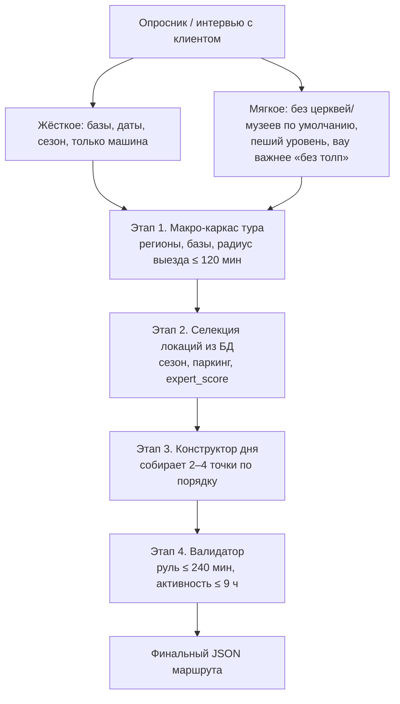

# Мы внимательно прочитали и изучили твою схему составления маршрута

Пока что нам здесь многое непонятно.  
Поэтому ниже: сначала **твоя схема наглядно и на пальцах** (как мы её поняли), потом два аспекта проверки, потом вопросы к тебе — чтобы пойти дальше.

---

## Твоя схема — как мы её видим (на пальцах)

### То же словами, сверху вниз

**Старт — опросник.**  
Клиент отвечает. Из ответов два мешка:

- **Жёсткое** — без этого тур не строим: как часто меняем базы, даты/сезон, едем только на машине.
- **Мягкое** — вкус: по умолчанию без церквей и музеев, насколько человек готов ходить пешком, «вау» важнее, чем «без толп».

**Этап 1 — крупная рамка тура.**  
Не точки дня, а скелет всего отпуска: какие регионы по пути от/до аэропорта, где ночуем (базы), из базы радиально не дальше **120 минут** в одну сторону. Транзитный день набиваем точками только если на трассе реально есть топ.

**Этап 2 — выбираем кандидатов из базы мест.**  
Отсекаем закрытое по сезону и плохое с парковкой/ZTL. Сортируем по красоте/силе (`expert_score`): топ бьёт серое. Далеко съезжать с трассы (крюк 30–60 мин) можно только за очень сильную точку (score ≥ 90).

**Этап 3 — вот здесь день собирается.**  
Из кандидатов складываем один день: **2–4 точки** по порядку. Формула: 1–2 «природы» днём + вечером городок с рестораном. Утро — активность, вечер — город. На обычную точку закладываешь слот **2–4 часа**.

**Этап 4 — проверка уже собранного дня.**  
Сложили руль по дороге: больше **240 минут**? Режем слабые точки. Вся активность больше **9 часов**? Тоже режем. День 1 был тяжёлым перегоном (≥ 3 ч)? Тогда день 2 делаем щадящим.

**Финиш — один JSON.**  
Без вариантов «на выбор»: один готовый маршрут.

### Где у нас затык в этой картинке

По схеме ясно: **день рождается на Этапе 3**, на Этапе 4 его только проверяют.  
Не ясно: **кто в коде крутит Этап 3** и что у него на входе/выходе. Без этого Этап 4 (руль, визит) не к чему применить.

---

## Два аспекта Этапа 4 — разберём на пальцах

Вопросов к Этапу 4 на самом деле больше.  
Пока берём только эти два — они **второстепенные** (после главного про Этап 3). Остальное Этапа 4 позже.

### 1. Суточное вождение (`daily_drive_limit`)

Сколько человек просидел **за рулём** за один день.  
Ты: не больше **240 минут** (4 часа). Считаем только дорогу: база → точка1 → точка2 → … Гуляние и обед **не** входят. Больше 240 — выкидываем самую дальнюю точку и считаем снова.

### 2. Слот на объект (`visit_slot`)

Сколько люди **стоят на месте** у точки.  
Ты: обычная точка **2–4 часа**; фото/смотровая **20–40 минут**. Это не руль — другое ведро минут. Потом вместе с рулём смотрите, не раздулся ли день по активности (у тебя ещё потолок ~9 часов).

---

## Ответь, пожалуйста, на вопросы

Нам нужны прямые ответы «как делаем», не пересказ схемы ещё раз.

### Главный вопрос — про Этап 3 на твоей схеме

Мы читаем так: день собирает **Этап 3**, Этап 4 только проверяет. Если не так — поправь.

Если так — как реализуешь Этап 3:
- **Кто крутит:** наш PHP, дообученная модель, обычный Gemini, каркас архетипа из базы?
- **Вход:** пул из Этапа 2 + база дня из Этапа 1?
- **Выход в Этап 4:** места по порядку (id) + база/отель этого дня?

### Второстепенные — уже из готового дня (Этап 4)

1. **Руль ≤ 240.** Откуда минуты дороги между точками: Google, OSRM, таблица в нашей БД?
2. **Визит.** Откуда минуты «на месте», если поле визита у локации не заполняем: константа, тип точки, или минуты в JSON дня при сборке?
